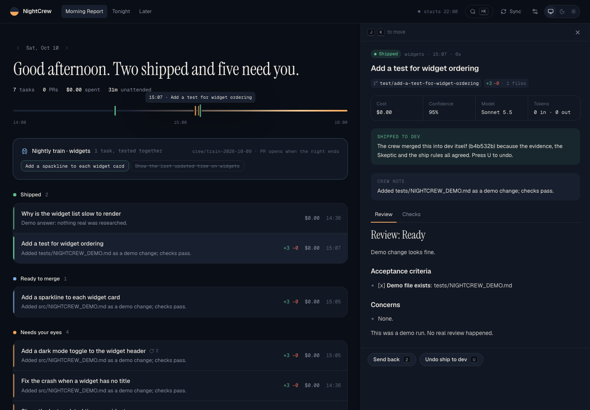

# NightCrew

Queue it at night. Merge it with coffee.

NightCrew runs your coding tasks overnight with Claude, across all your repos. Every task comes back with a plan, evidence that it works, and a review by a separate agent whose job is to prove it doesn't. In the morning you clear one calm report, one key per decision.



> **1.0 alpha.** The bash runner from 0.x still works and lives in [`classic/`](classic/README.md).

## Install

```bash
curl -fsSL https://raw.githubusercontent.com/oluoyefeso/nightcrew/main/install.sh | sh
```

NightCrew needs `git`, the GitHub CLI (`gh auth login`), and either Claude Code (logged in) or `ANTHROPIC_API_KEY`.

```bash
cd ~/code/my-app
nightcrew repo add        # detects the test, install and preview commands
nightcrew                 # opens the dashboard at http://localhost:3721
```

Describe tonight's work in the dashboard, or from a terminal:

```bash
nightcrew add "Dark mode that follows the system, and fix the crash when a widget has no title"
```

The crew starts at 22:00 (change it in Settings), or press **Run now**. Try everything without spending anything with `nightcrew --demo`.

## What a night looks like

1. **Tonight.** You describe the work. NightCrew drafts task cards with scope, acceptance criteria, the evidence it will need and a budget, and asks one question if something is unclear.
2. **Overnight.** Each task gets its own git worktree and an isolated Claude session.
   - Small tasks build directly; bigger ones plan first.
   - Every tool call passes a guard that refuses writes outside scope, pushes, publishing, secrets and protected branches.
   - NightCrew runs your tests itself and gives a failing task one repair attempt.
   - It then gathers evidence and hands everything to the Skeptic.
3. **Morning.** The Morning Report groups the night into Shipped, Ready to merge, Needs your eyes, Sent back and Failed, laid out on the Horizon, the night drawn as a time axis.
   - `1` merges.
   - `2` sends a task back with a note; it runs again tonight on the same branch.
   - `3` dismisses.
   - `H` tries again tonight.
   - `U` undoes.

## Evidence, not claims

NightCrew collects evidence itself, independent of what the agent says:

- **UI tasks.** Before and after screenshots at desktop and mobile, in light and dark, taken from a preview of the base branch and of the task branch. Also a pixel diff, an accessibility scan (only new issues count) and console errors.
- **Bug fixes.** A new test that fails on the base branch and passes on the fix. A test that passes either way gets flagged.
- **Every task.** NightCrew's own checks on scope, tests and protected paths.

The **Skeptic** reviews with that evidence and records each challenge it made and whether it held. Missing evidence always sends the task to Needs your eyes. See [docs/evidence.md](docs/evidence.md).

## The trust ladder

Each repo earns autonomy from its track record:

| Level | What the crew may do |
|---|---|
| Propose | Plans only, no code |
| Draft PR | One draft PR per task (the default) |
| Nightly train | Ready tasks merge into `crew/train-<night>` and are tested together; you merge one PR |
| Ship to dev | The crew merges into your ship branch itself when evidence, the Skeptic, an 80% confidence score and your path rules all agree. `U` reverts it and drops the repo back to the train |

`main`, the default branch and anything you protect are never touched. NightCrew suggests a promotion when the record earns it ("8 of the last 10 tasks merged without changes"). See [docs/trust-ladder.md](docs/trust-ladder.md).

## Cost

A small task costs about **$0.08** end to end (build, check, review, commit). That figure is measured, not estimated. Each crew session runs isolated: no filesystem settings, MCP servers, skills or plugins from your machine, only the repo's own `CLAUDE.md` / `AGENTS.md`. On a typical setup that measured 48× cheaper per turn, and it keeps the agent's tools to what the task needs. Nightly and per-task budgets are hard caps.

## More

- [Getting started](docs/getting-started.md)
- [Configuration](docs/configuration.md): repos, budgets, models, preview commands, Jev
- [Evidence](docs/evidence.md)
- [Trust ladder](docs/trust-ladder.md)
- [Managed mode](docs/managed.md) (experimental): run the crew on Claude Managed Agents
- [Design system](DESIGN.md)

## Development

```bash
bun install
bun run dev          # dashboard on :5173 (Vite) with the API on :3721
bun test             # unit and integration tests (real git repos, headless Chrome)
bun run typecheck
bun run lint
bun run build        # dashboard + single nightcrew binary in apps/cli/dist
bun run classic:test # the 0.x bats suite
```

| Path | What lives there |
|---|---|
| `apps/web` | The dashboard: React 19, Vite 8, TanStack Router and Query, Tailwind 4 |
| `apps/cli` | The `nightcrew` binary: Hono API, scheduler, classic importer, embedded dashboard |
| `apps/site` | The landing page |
| `packages/core` | Domain model, report logic, the tool-call guard |
| `packages/db` | SQLite schema (Drizzle) and queries |
| `packages/runner` | Agent engines (Agent SDK, Managed Agents, demo), pipeline, evidence, trust ladder, reflexes |
| `classic/` | The 0.x bash runner |

## License

MIT
