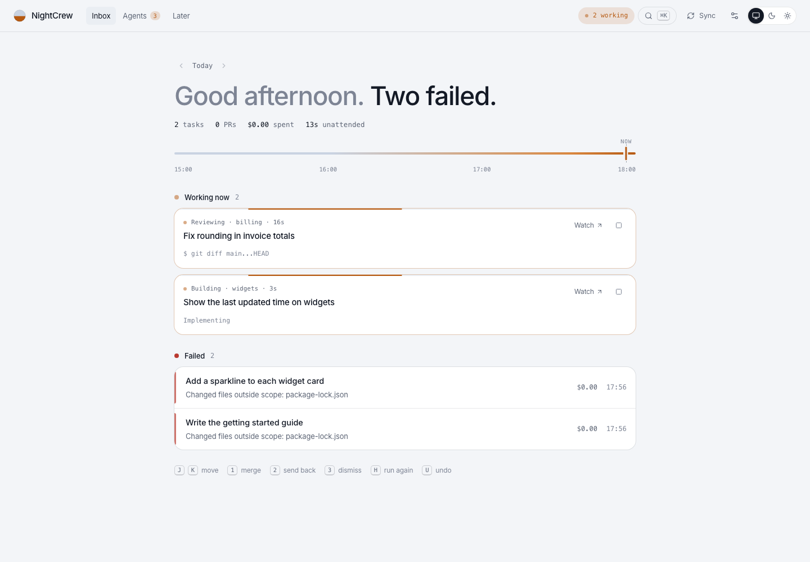
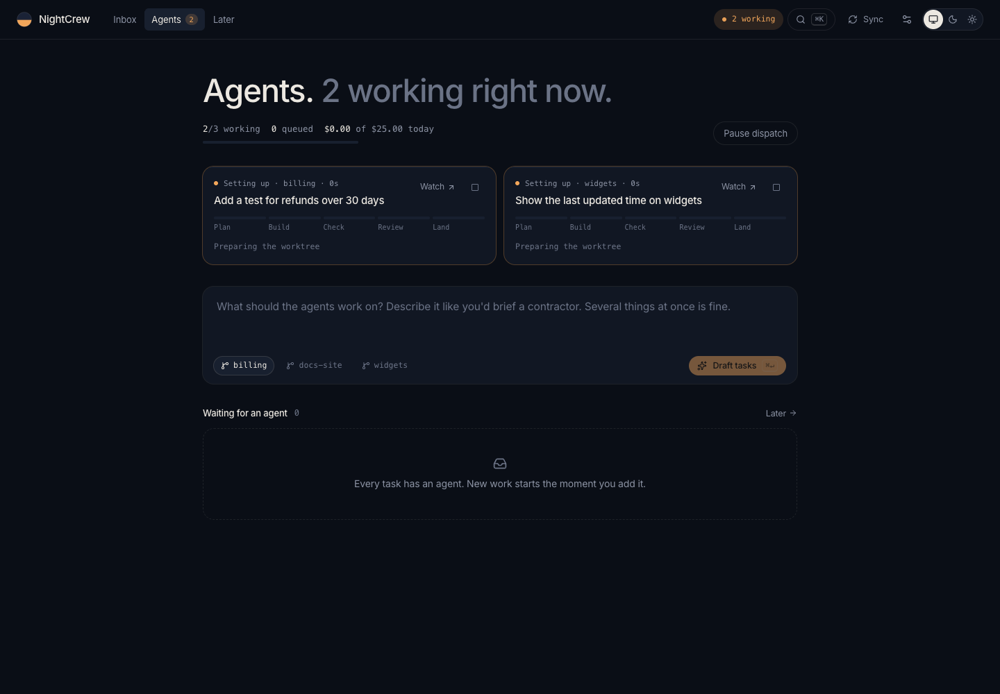

# NightCrew

Dispatch the work. Judge the evidence.

NightCrew is a control room for coding agents. Describe the work and agents start right away, in parallel, across your repos, inside guardrails you set. Each one comes back with evidence that it works, a review by a separate agent whose job is to prove it doesn't, and a status report you can judge in seconds. Day or night: you manage the crew, the agents do the work.



> **1.0 alpha.** The bash runner from 0.x still works and lives in [`classic/`](classic/README.md).

## Install

```bash
curl -fsSL https://raw.githubusercontent.com/oluoyefeso/nightcrew/main/install.sh | sh
```

NightCrew needs `git`, the GitHub CLI (`gh auth login`), and either Claude Code (logged in) or `ANTHROPIC_API_KEY`.

```bash
cd ~/code/my-app
nightcrew repo add        # detects the test, install and preview commands
nightcrew                 # prints a dashboard link and opens it
```

The link (`http://localhost:3721/?t=…`) carries a key that changes every launch. With `--no-open`, or after a restart, open the link `nightcrew` just printed.

Give the agents work in the dashboard, or from a terminal:

```bash
nightcrew add "Dark mode that follows the system, and fix the crash when a widget has no title"
```

Agents start as soon as a slot is free: up to 3 at once and 1 per repo by default, within a 20M-token daily budget (all adjustable). Add `--schedule` to hold work for off-peak, or `--later` to park it. Try everything without spending anything with `nightcrew --demo`.

## How it works

1. **Dispatch.** Describe the work. NightCrew drafts task cards with scope, acceptance criteria, the evidence it will need and a token budget, and asks one question if something is unclear. Run now, schedule it, or park it in Later.
2. **Agents work, in parallel.** The **Agents** page shows every agent live: its phase, its last step, and a Stop button.
   - Each task gets its own clone of the repo (under `~/.nightcrew/work`) and an isolated Claude session, and lands by commit.
   - Small tasks build directly; bigger ones plan first.
   - Every tool call passes a guard that refuses writes outside scope, pushes, publishing, secrets and protected branches.
   - NightCrew runs your tests itself and gives a failing task one repair attempt, then gathers evidence and hands it to the Skeptic.
3. **They report back.** Reports land in the **Inbox** as agents finish, grouped into Shipped, Ready to merge, Needs your eyes, Sent back and Failed, and laid out on the Horizon (the day as a time axis). Desktop and Slack notifications are optional.
   - `1` merges.
   - `2` sends a task back with a note; an agent picks it up on the same branch.
   - `3` dismisses.
   - `H` runs it again.
   - `U` undoes.



## Evidence, not claims

NightCrew collects evidence itself, independent of what the agent says:

- **UI tasks.** Before and after screenshots at desktop and mobile, in light and dark, taken from a preview of the base branch and of the task branch. Also a pixel diff, an accessibility scan (only new issues count) and console errors.
- **Bug fixes.** A new test that fails on the base branch and passes on the fix. A test that passes either way gets flagged.
- **Every task.** NightCrew's own checks on scope, tests and protected paths.

The **Skeptic** reviews with that evidence and records each challenge it made and whether it held. Missing evidence always sends the task to Needs your eyes. See [docs/evidence.md](docs/evidence.md).

## The trust ladder

Each repo earns autonomy from its track record:

| Level | What the crew may do |
|---|---|
| Propose | Plans only, no code |
| Draft PR | One draft PR per task (the default) |
| Daily train | Ready tasks merge into `crew/train-<day>` and are tested together; you merge one PR |
| Ship to dev | The crew merges into your ship branch itself when evidence, the Skeptic, an 80% confidence score and your path rules all agree. `U` reverts it and drops the repo back to the train |

`main`, the default branch and anything you protect are never touched. NightCrew suggests a promotion when the record earns it ("8 of the last 10 tasks merged without changes"). See [docs/trust-ladder.md](docs/trust-ladder.md).

## Tokens

A small task uses about **100k tokens** end to end (build, check, review, commit). That's measured, not estimated. Each agent session runs isolated: no filesystem settings, MCP servers, skills or plugins from your machine, only the repo's own `CLAUDE.md` / `AGENTS.md`. The same tasks took 2.3M–4.4M tokens in a session that loaded everything on the machine, so that's 20–40× fewer, with the agent's tools kept to what the task needs. Every task has a token budget the agent stops at, and the daily token budget holds new agents back rather than letting them pass it.

## More

- [Getting started](docs/getting-started.md)
- [Configuration](docs/configuration.md): repos, budgets, models, preview commands, Jev
- [Evidence](docs/evidence.md)
- [Trust ladder](docs/trust-ladder.md)
- [Security](docs/security.md): the guard, the OS sandbox, the push block and the local API
- [Managed mode](docs/managed.md) (experimental): run the crew on Claude Managed Agents
- [Design system](DESIGN.md)

## Development

```bash
bun install
bun run dev          # dashboard on :5173 (Vite) with the API on :3721
bun test             # unit and integration tests (real git repos, headless Chrome)
bun run typecheck
bun run lint
bun run build        # dashboard + single nightcrew binary in apps/cli/dist
bun run classic:test # the 0.x bats suite
```

| Path | What lives there |
|---|---|
| `apps/web` | The dashboard: React 19, Vite 8, TanStack Router and Query, Tailwind 4 |
| `apps/cli` | The `nightcrew` binary: Hono API, scheduler, classic importer, embedded dashboard |
| `apps/site` | The landing page |
| `packages/core` | Domain model, report logic, the tool-call guard |
| `packages/db` | SQLite schema (Drizzle) and queries |
| `packages/runner` | Agent engines (Agent SDK, Managed Agents, demo), pipeline, evidence, trust ladder, reflexes |
| `classic/` | The 0.x bash runner |

## License

MIT
